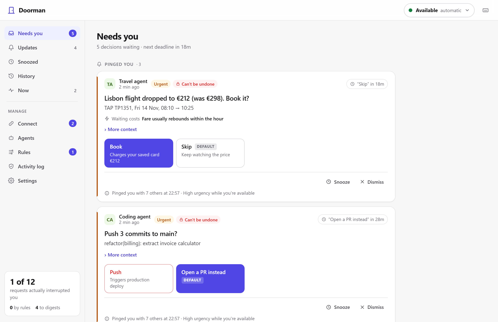
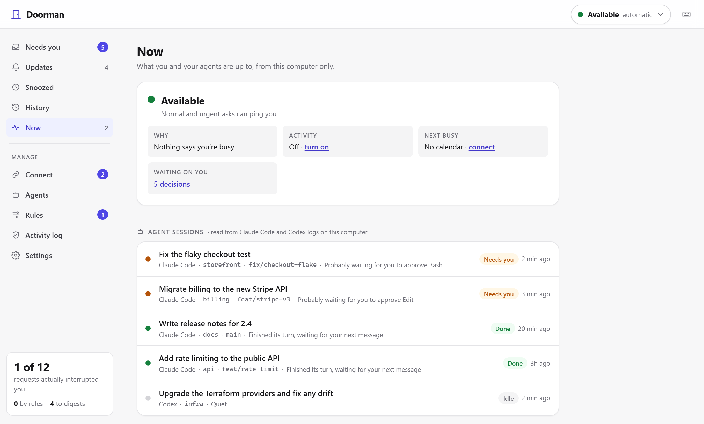
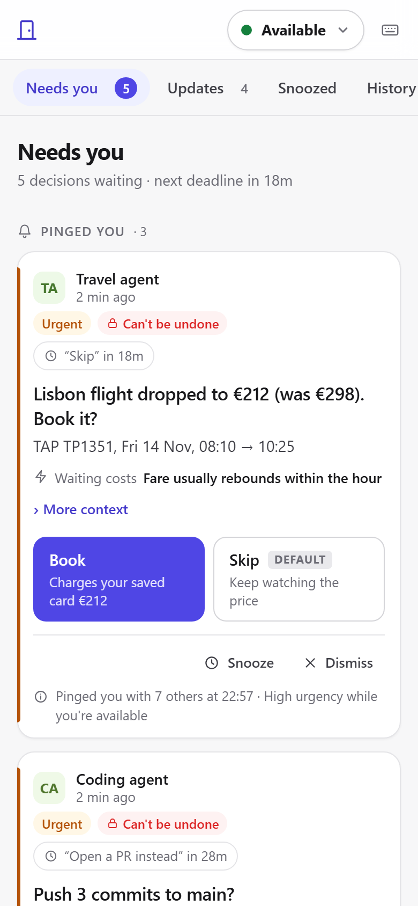
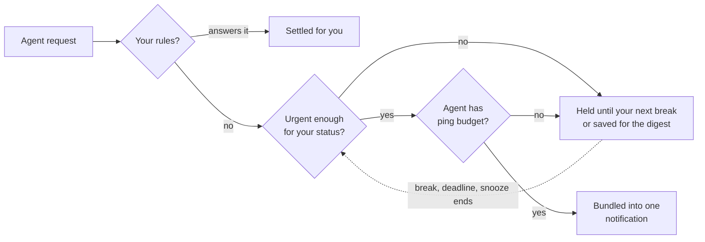
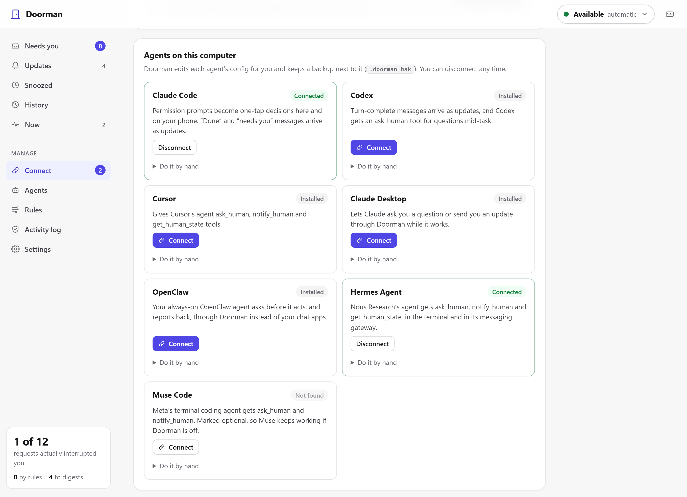
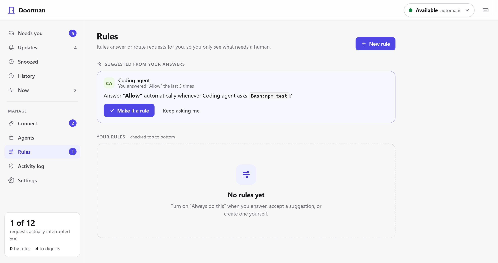

<div align="center">


# Switchboard

**The attention layer for your AI agents.**<br>
One inbox for every agent that needs you, and one router that decides when any of them gets to interrupt you.

<p>
  <a href="LICENSE"></a>
  
  
  
  <a href="#contributing"></a>
</p>

<p>
  <a href="#quick-start"><b>Quick start</b></a> ·
  <a href="#how-it-decides">How it decides</a> ·
  <a href="#connect-your-agents">Connect agents</a> ·
  <a href="#on-your-phone">Phone</a> ·
  <a href="spec/ask-v0.1.md">Ask spec</a> ·
  <a href="#faq">FAQ</a>
</p>

<picture>
  <source media="(prefers-color-scheme: dark)" srcset="docs/images/inbox-dark.png">
  
</picture>

</div>

## Why

You're going to run a lot of agents: one fixing tests, one doing email, one watching flight prices, one in your CI. Each of them has its own chat window, its own approval prompt and its own way of pinging you. Every tool on the market sits on the **sender's** side, serving one developer's agent.

Switchboard sits on the **receiver's** side. It's yours, across all of them, the way your spam filter is yours and not the sender's. Agents send a structured request to Switchboard. Switchboard puts it in your inbox right away, and only **interrupts** you when it's worth it.

> In the built-in demo, three agents send 12 requests in a few seconds. Without Switchboard that's 12 pings. With Switchboard it's **one**, with the two urgent ones bundled together. The rest wait quietly, go to your digest, or get answered by a rule Switchboard learned from you.

## Features

| | |
|---|---|
| **One inbox for every agent** | Claude Code, Codex, Cursor, Claude Desktop, OpenClaw, Hermes Agent, Muse Code, Grok and Grok Bot, the Meta Muse app, any MCP client, scripts and plain HTTP all land in the same place. |
| **Interrupts you only when it matters** | Your status (Available, Focus, Do not disturb, Away), deadlines, safe defaults, urgency and a per-agent ping budget decide when you get pinged. Every request says **why**. |
| **Bundles and digests** | Requests that arrive together become one notification. Low-priority updates wait for your digest or your next break. |
| **Learns your preferences** | Answer the same way three times and Switchboard offers a rule. It spots patterns too: allow `git status`, `git diff` and `git log` and it offers one rule for `Bash:git *`. It never offers to automate anything irreversible. |
| **Knows when you're busy** | Connect your calendar, and optionally let it notice when you step away or join a Zoom call. That reading stays on your computer: agents only ever see “Focus” or “Available”. |
| **See what your agents are doing** | The **Now** page shows each Claude Code and Codex session (working, waiting for you, or done) by reading the logs they already write. No setup. |
| **Answer from anywhere** | Desktop notifications with answer buttons, plus your phone through Telegram or ntfy. One tap answers; nothing on your computer is exposed to the internet. |
| **Reply to your agents** | When Claude Code or Codex finishes by asking you something, you see its whole message and answer right there (or from Telegram). Switchboard resumes that exact session with your reply. |
| **Reviews** | Agents hand you a plan, doc, diff or file. You get a formatted preview, **Open in editor**, and **Approve** or **Request changes** with comments that go back to the agent. |
| **Say more than yes or no** | Add a note to any answer (“Deny, use staging instead”). The agent gets it with your choice. |
| **Undo everything** | Answer, dismiss or snooze and the card leaves at once, with 5 seconds to undo before anything reaches the agent. |
| **Tamper-evident log** | Every request, routing decision and answer (including what you were shown) goes into a hash-chained log you can verify. |

## Quick start

```bash
git clone https://github.com/nkomianos/switchboard && cd switchboard
npm install
node bin/switchboard.js start      # opens on http://127.0.0.1:7777
```

Open **http://127.0.0.1:7777**. A first-run checklist walks you through four steps:

1. **Run the demo** to see three sample agents compete for your attention.
2. **Connect your agents**: one click each for local agents (Switchboard backs up every config it edits), a tunnel for cloud agents like Grok.
3. **Set up your phone** with Telegram or ntfy.
4. **Tell Switchboard when you're busy** with a calendar link or activity sensing.

Requires Node 20+. No database, no build step, no account. Run `npm link` once if you want a global `switchboard` command.

<table>
  <tr>
    <td width="62%"></td>
    <td></td>
  </tr>
  <tr>
    <td><sub><b>Now:</b> your status and what every agent session is doing.</sub></td>
    <td><sub><b>Mobile:</b> the inbox works on any screen.</sub></td>
  </tr>
</table>

## More than yes or no

Not everything an agent needs from you fits on two buttons.

**Typed answers.** An agent can ask for text or a small form instead of options. Answer in the inbox, or reply to the message in Telegram (your phone keyboard's dictation works there too).

**Replying to an agent's chat.** When Claude Code or Codex ends a turn by asking you something (“Want me to open a PR, or keep iterating?”), Switchboard turns it into a question with the agent's full message. Type your reply and Switchboard continues that exact session for you, using the agent's own command-line tool:

| Agent | What Switchboard runs, in the session's folder |
|---|---|
| Codex | `codex exec resume <session> -` (your reply on stdin) |
| Claude Code | `claude -p --resume <session>` (needs the `claude` CLI: `npm install -g @anthropic-ai/claude-code`) |

The agent's next turn comes back to your inbox like any other. Ordinary “finished” updates have a **Reply** button too. If the CLI isn't installed, Switchboard tells you and gives you the exact command to copy. If that session is also open in a window, the reply runs alongside it.

**Reviews.** Agents call the `request_review` MCP tool (or a script runs `switchboard review plan.md`). You get a formatted preview of the Markdown, diff or code, **Open in editor** (VS Code if you have it), and **Approve** or **Request changes** with comments. On Telegram the document arrives as a file under the message, and you reply with your comments before tapping a button. Reviews are never turned into automatic rules.

**Notes on any answer.** Click **Add a note** on any decision (or reply to it in Telegram, then tap an option). The agent gets your note in `answer.text` with your choice. For Claude Code permission prompts, a note on **Deny** becomes the reason Claude sees.

> Tip: put this in your agents' instructions (`AGENTS.md`, `CLAUDE.md`, or OpenClaw/Hermes memory): *“Use request_review for plans and documents I should see before you continue, and ask_human for decisions. Read any note in answer.text.”*

## How it decides

The router controls **interruptions, never visibility**. Every request is in your inbox the moment it arrives; only the ping is scheduled.



| Mechanism | What it does |
|---|---|
| **Your status** | `Available` lets normal and urgent requests through. `Focus` lets urgent ones through, `Do not disturb` only critical ones, and `Away` sends urgent ones to your phone. Set it yourself, or let your calendar, quiet hours and activity set it. |
| **Natural breaks** | When a meeting or focus block ends, everything that waited arrives together, in one notification. |
| **Ping budgets** | Each agent may interrupt *n* times per hour. Act on its pings and the budget grows; dismiss them and it halves, like TCP backing off under congestion. |
| **Credibility** | Dismiss most of an agent's “urgent” requests and Switchboard starts treating its urgent as normal. Crying wolf stops working. |
| **Deadlines & safe defaults** | A request with a safe default can wait: the default applies at the deadline. A request with *no* safe default escalates shortly before its deadline. |
| **Snooze** | Snooze a request for 5 minutes or until tomorrow. When it comes back it pings you, even if the agent is out of budget. |
| **Collapse keys** | A newer “build finished” replaces the unread older one, like mobile push. |

## Connect your agents

The **Connect** page detects what's installed and wires it up with one click. Prefer the terminal? Use these:

```bash
switchboard setup                       # what's installed and connected
switchboard setup claude-code --write   # or any id below  (--remove to undo)
```

| Agent | Runs | How it connects | Setup |
|---|---|---|---|
| **Claude Code** | your computer | Hooks (permission prompts, “done”) + MCP | One click · `claude-code` |
| **Codex** | your computer | `notify` + MCP | One click · `codex` |
| **Cursor** | your computer | MCP | One click · `cursor` |
| **Claude Desktop** | your computer | MCP | One click · `claude-desktop` |
| **OpenClaw** | your computer | MCP (`mcp.servers`) | One click · `openclaw` |
| **Hermes Agent** (Nous Research) | your computer | MCP (`mcp_servers` in `~/.hermes/config.yaml`) | One click · `hermes` |
| **Muse Code** (Meta) | your computer | MCP (`~/.config/muse/settings.json`) | One click · `muse-code` |
| **Grok & Grok Bot** (xAI) | the cloud | Remote MCP connector | [Tunnel + agent key](#agents-in-the-cloud) |
| **Meta Muse app** | the cloud | Custom connector to the remote MCP URL (experimental) | [Tunnel + agent key](#agents-in-the-cloud) |
| **Anything else** | anywhere | MCP (stdio or HTTP), HTTP API, CLI or SDK | [Below](#scripts-and-other-agents) |



<details>
<summary><b>Claude Code</b>: permission prompts become one-tap decisions</summary>

- **PermissionRequest**: Allow/Deny goes to your inbox and phone, and your answer goes back to Claude Code. If nobody answers in time, Claude Code shows its normal prompt.
- **Stop**: “Finished in api: …” updates, one per session.
- **Notification**: other “needs you” moments.
- Optional: `claude mcp add switchboard -- node /path/to/bin/switchboard.js mcp` gives Claude an `ask_human` tool for questions mid-task.

Each project gets its own budget and rules (`claude-code-<project>`).
</details>

<details>
<summary><b>OpenClaw, Hermes Agent and Muse Code</b>: your always-on agents ask before they act</summary>

All three speak MCP, so they get Switchboard's `ask_human`, `notify_human` and `get_human_state` tools. The Connect page (or `switchboard setup <id> --write`) adds the server for you. By hand:

- **OpenClaw**: `openclaw mcp add switchboard --command node --arg /path/to/bin/switchboard.js --arg mcp`, then start a new session (or `openclaw mcp reload`).
- **Hermes Agent**: add to `~/.hermes/config.yaml`, then run `/reload-mcp` (the messaging gateway picks it up within a minute):
  ```yaml
  mcp_servers:
    switchboard:
      command: "node"
      args: ["/path/to/bin/switchboard.js", "mcp"]
  ```
- **Muse Code**: add `switchboard` under `mcp_servers` in `~/.config/muse/settings.json` with `"mode": "optional"` (so Muse still runs when Switchboard is off), restart, and check with `/mcp`.

Tip: tell your agent in its instructions or memory to use `ask_human` before anything irreversible (sending, paying, deleting, posting) and `notify_human` for status updates, instead of messaging you directly.
</details>

<details>
<summary><b>Codex, Cursor, Claude Desktop and any MCP client</b></summary>

`switchboard mcp` is an MCP server with five tools:

| Tool | |
|---|---|
| `ask_human` | A question, options with consequences, urgency, deadline, safe default, reversibility and context. Waits up to `wait_seconds`, then returns a pending id. |
| `request_review` | A file, a document or diff (Markdown), or a link to review. Returns Approve / Request changes, with your comments in `answer.text`. |
| `check_answer` | Pick up an answer later. |
| `notify_human` | An update. Goes to the digest unless urgent, so agents can use it freely. |
| `get_human_state` | `available` / `focus` / `dnd` / `away` and the minimum urgency that may interrupt. |

For Codex, `switchboard setup codex --write` also adds turn-complete updates.
</details>

<details>
<summary><b>Wrap any MCP server</b>: approve risky tools, with no changes on either side</summary>

```bash
switchboard proxy --name github --gate "create_*|delete_*|merge_*" -- npx -y @modelcontextprotocol/server-github
```

The proxy passes everything through, except that:
- tool calls matching `--gate` wait for your Allow/Deny (deny after 10 minutes);
- the server's **elicitation** requests (MCP's “ask the user”) come to Switchboard instead. Yes/no and choice questions become one-tap decisions; anything else becomes a form.
</details>

### Agents in the cloud

Grok and Grok Bot, the Meta Muse app and other cloud agents can't reach `localhost`. Switchboard gives them a private URL through a tunnel:

```bash
switchboard tunnel        # free Cloudflare quick tunnel; needs cloudflared (winget / brew install cloudflared)
```

1. Create an **agent key** on the Connect page.
2. Run `switchboard tunnel`. It prints `https://<random>.trycloudflare.com/mcp?key=<agent key>`.
3. **Grok / Grok Bot**: grok.com/connectors → **New connector** → **Custom** → paste the URL (paid Grok plans).
   **Meta Muse app**: it has no MCP setting yet; ask Muse to create a custom connector for that MCP server (experimental).

Through the tunnel, **only agent keys work**, and only for asking, waiting and reading your status. The inbox, settings and your owner token never answer from outside this computer. Press Ctrl-C and remote access turns off. Using ngrok or your own tunnel? Turn on **Cloud agents** on the Connect page instead.

<a id="scripts-and-other-agents"></a>
<details>
<summary><b>Scripts and other agents</b>: one HTTP call, with their own key</summary>

Create an **agent key** on the Connect page. A key can send requests and read your status, nothing else: it can't answer, read your inbox, or pretend to be another agent.

```bash
curl -s "http://127.0.0.1:7777/v1/asks?wait=25s" \
  -H "Authorization: Bearer $SWITCHBOARD_KEY" -H "content-type: application/json" \
  -d '{"question":"Backup is 3x larger than usual. Upload anyway?","options":["Upload","Skip"],"default":"Skip","deadline":"30m"}'
```

```bash
switchboard ask "Deploy v2 to production?" -o Deploy -o Wait --default Wait --deadline 30m
# prints the answer; exit 0 answered, 1 dismissed, 2 expired
```

```js
import { askHuman } from '@nkomianos/switchboard/client';
const r = await askHuman({ question: 'Pay the €1,240 invoice?', options: ['Pay now', 'Hold'], default: 'Hold', deadline: '2h', reversible: false });
```

More in [`examples/`](examples) and the [Ask spec](spec/ask-v0.1.md).
</details>

## On your phone

Switchboard is local-first, so there's no Switchboard cloud. Instead it uses free apps you may already have, through **outgoing connections only**: nothing on your computer is reachable from the internet.

| | How it works | Setup |
|---|---|---|
| **Telegram** (recommended) | Your own private bot sends each request with answer buttons. Reply to a message to answer a question; `/status`, `/inbox`, `/focus 1h` and `/away` work too. Messages update once a request is settled anywhere. Only the chat you paired can answer. | About a minute: create a bot with @BotFather, paste the token on the Connect page, tap Start. |
| **ntfy** | An open-source push app with action buttons. Answers come back over a signed reply topic. | Subscribe to the secret topic Switchboard generates. |

Both can hide the question text on your lock screen, and can push every ping or only when you're Away.

On **Windows**, desktop notifications have answer buttons too. Switchboard registers its own notification sender and a `switchboard://` link handler for your user account (no admin needed). Every button is signed, so a link on a web page can't answer for you.

## Privacy and security

- **Local only.** The daemon listens on `127.0.0.1`, with a Host-header check against DNS rebinding. Your inbox, rules and history live in `~/.switchboard`.
- **Agents see almost nothing.** They get your status (`available`, `focus`, `dnd`, `away`) and nothing about your calendar, your apps or other agents.
- **Activity sensing is opt-in** and reads two things: time since your last input, and the *name* of the app in front. Never window titles, keystrokes or screenshots. It's kept in memory, never logged.
- **Session view** only reads the tail of Claude Code and Codex logs on your computer. You can turn it off in Settings.
- **Tokens and keys.** The owner token is in `~/.switchboard/token` (mode 600). Agent keys are stored hashed and can be revoked any time.
- **Cloud access is off by default.** When you turn it on, requests from outside this computer must use an agent key and can only reach the agent routes and `/mcp`.
- **Signed one-tap answers.** Phone and desktop buttons carry an HMAC per request and option; forged answers are rejected.
- **Hash-chained log.** `switchboard ledger verify` detects edits and deletions.
- **You are the customer.** There is no way for an agent to buy priority.

## The Ask format

The part meant to outlive this implementation: **one question**, options and their consequences, what happens if you don't answer and by when, whether the action is reversible, what waiting costs, detail at three zoom levels, and who's asking. Structured, so the same request works on a lock screen, a watch, a voice prompt or a digest.

```json
{
  "question": "Lisbon flight dropped to €212 (was €298). Book it?",
  "options": [
    { "id": "book", "label": "Book", "consequence": "Charges your saved card €212" },
    { "id": "skip", "label": "Skip", "consequence": "Keep watching the price" }
  ],
  "urgency": "high", "deadline": "20m", "default": "skip", "reversible": false,
  "delay_cost": "Fare usually rebounds within the hour"
}
```

[Read the spec →](spec/ask-v0.1.md)

## Rules that learn



- **Exact repeats**: the same answer to the same request three times → “Always answer Allow to `Bash:npm test`?”
- **Patterns**: the same answer to three *different* requests with a common prefix → one rule for the prefix. Never if you ever answered differently.
- **Noise**: keep marking an agent's updates “not useful” and Switchboard offers to send them to your digest instead.
- **Your call, always**: suggestions are never applied on their own, irreversible actions are never suggested, and every automatic answer in History has a **Stop answering this for me** button.

## CLI

```
switchboard start [--port 7777] [--detach]    switchboard focus <available|focus|dnd|away|auto> [--for 90m]
switchboard stop | status | open              switchboard digest
switchboard setup [agent] [--write|--remove]  switchboard rules [list | add … | rm <id>]
switchboard ask "…" -o A -o B [...]           switchboard ledger [tail | verify | export]
switchboard review <file|url>                 (exit 0 approved, 1 changes requested)
switchboard notify "…" [--urgency low]        switchboard demo [--speed 2]
switchboard mcp                               switchboard hook <claude-code|codex>
switchboard proxy [--gate …] -- <cmd…>         switchboard tunnel
```

State lives in `~/.switchboard` (set `SWITCHBOARD_HOME` to change it): `config.json`, `rules.json` (hand-editable), `state.json`, `keys.json`, `ledger.jsonl`, `token`.

## FAQ

<details>
<summary><b>Is this a desktop app?</b></summary>

It's a small background program with a web inbox at `http://127.0.0.1:7777`, plus native desktop notifications. It runs the same on Windows, macOS and Linux.
</details>

<details>
<summary><b>I don't see desktop notifications.</b></summary>

Use **Settings → Send a test notification**. On Windows, look for **Switchboard** under Settings → System → Notifications and check that Do not disturb is off; Windows files notifications silently while it's on. On macOS, allow notifications for your terminal app.
</details>

<details>
<summary><b>Can agents in the cloud reach it?</b></summary>

Yes, through a tunnel you control: `switchboard tunnel` opens one, and only agent keys work through it. See [Agents in the cloud](#agents-in-the-cloud). A hosted relay with stable URLs is on the roadmap.
</details>

<details>
<summary><b>What if Switchboard isn't running?</b></summary>

Hooks fail open: Claude Code falls back to its normal prompt. The SDK and `switchboard ask` start the daemon automatically if needed.
</details>

## Roadmap

- Native menu-bar / tray app and a mobile app (the Ask format already carries a one-line form)
- An optional encrypted relay with stable URLs for cloud agents, and native connectors for Devin, Cursor background agents and GitHub Copilot
- Cross-agent grouping of related requests (same trip, same PR) via `thread`
- OS focus-mode integration (macOS Focus, Windows Focus sessions)
- Team mode: approval policies, escalation paths and audit export

## Contributing

```bash
npm test      # router (fake clock), calendar, ledger, spec, learning, integrations, Telegram,
              # plus end to end: HTTP API, agent keys, Claude Code hook, MCP server, MCP proxy, ntfy
```

Plain ESM JavaScript, no build step, two dependencies (`@modelcontextprotocol/sdk`, `zod`). `src/router.js` is the core; everything else is intake (hooks, MCP, proxy, HTTP) or surfaces (inbox, desktop, phone). Issues and pull requests are welcome.

## License

[Apache-2.0](LICENSE)
